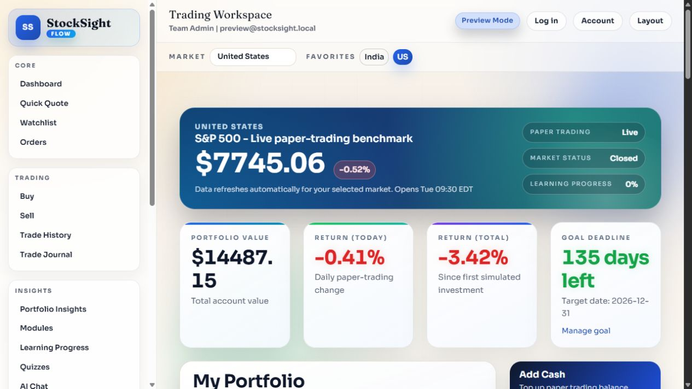
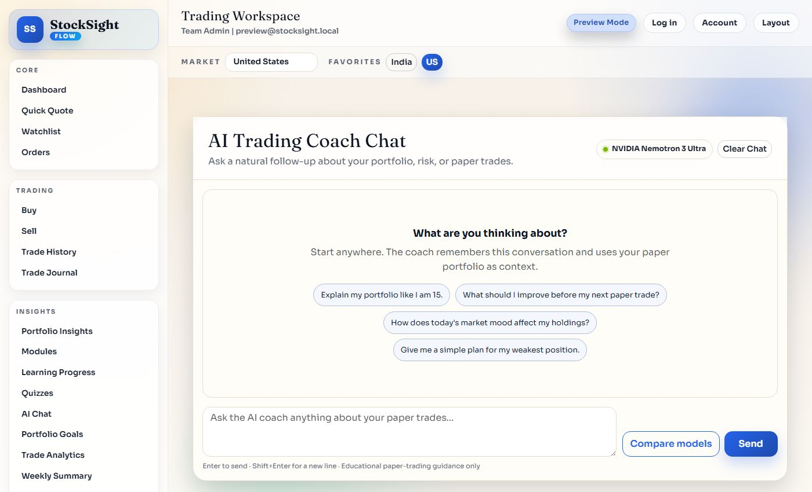
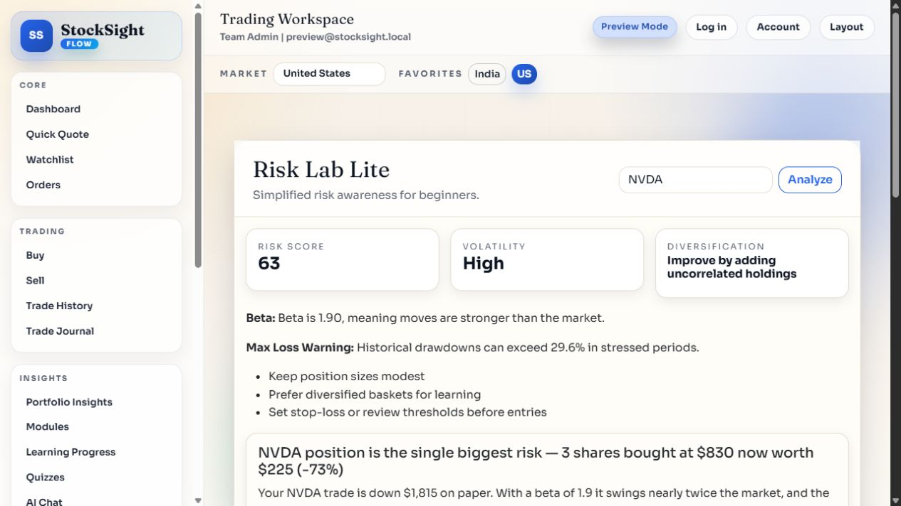

# StockSight Learner

StockSight Learner is a free Windows app for learning about stocks and practicing trades with a simulated portfolio. It includes watchlists, lessons and quizzes, a trade journal, a Risk Lab, and an AI Coach.

## Download for Windows

1. Open the [latest GitHub release](https://github.com/kianjindal2010/stocksight-flow/releases/latest).
2. Download `StockSightLearner-Updated.exe` under **Assets**.
3. Verify the download before opening it. In PowerShell, run:

   ```powershell
   Get-FileHash "$HOME\Downloads\StockSightLearner-Updated.exe" -Algorithm SHA256
   ```

   Compare the result with the SHA-256 checksum GitHub lists for that release's installer. Windows may warn that the installer is unsigned.

## Screenshots

| Dashboard | AI Coach | Risk Lab |
| --- | --- | --- |
|  |  |  |

## Download site development

Run `npm ci` and `npm run dev` from the repository root. Run `npm run build` to build the site for Vercel. The download button links to GitHub's latest release.

## Help

Email [kian.jindal2010@gmail.com](mailto:kian.jindal2010@gmail.com) with a screenshot, your Windows version, and what you were doing when the issue occurred.

StockSight is for education and paper trading. It does not provide investment advice.
